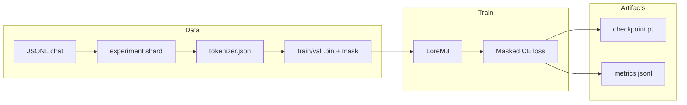
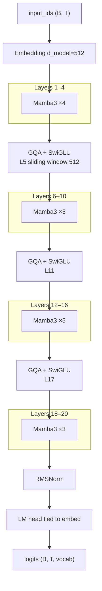
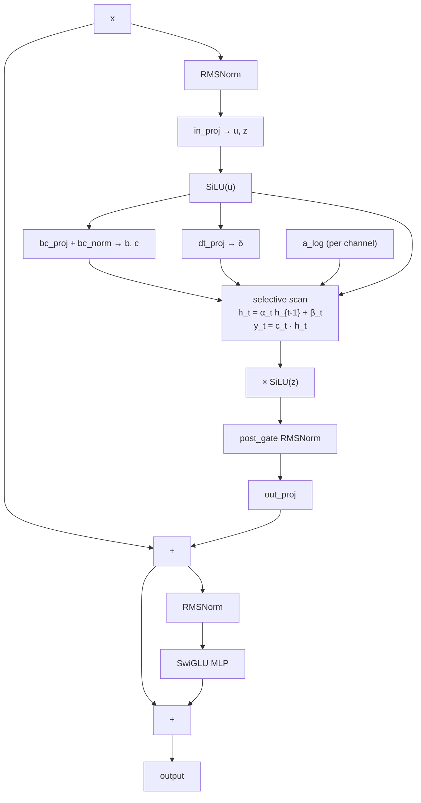
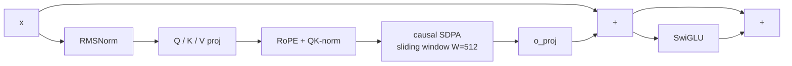

# Lore-M3

A from-scratch **causal language model** that mixes **Mamba-3-style state-space (SSM) blocks** with **grouped-query attention (GQA)**. Train on local chat JSONL on **Apple Silicon (MPS)** or **NVIDIA CUDA**, validate on a held-out set, then scale to multi-GB corpora with streaming.

Canonical hyperparameters: **`configs/experiment_100mb.yaml`**. Agent playbook: **[AGENTS.md](AGENTS.md)**.

---

## Architecture

**Model class:** `LoreM3` — ~**144M** parameters at default width (`d_model=512`, 20 layers, vocab 32k).

This repo’s **“Mamba-3”** blocks are a **compact, trainable** design (gated SISO selective scan, `bc_norm`, post-gate RMSNorm). They are **inspired by** the newer Mamba line but are **not** a drop-in of the full public **Mamba-2 SSD** (`mamba-ssm`) or a paper-complete **Mamba-3** stack. Production “Mamba” codebases often still use **Mamba-2 + fused kernels**; Lore-M3 prioritizes a **single hybrid LM** you can train end-to-end here.

### End-to-end pipeline



### Lore-M3 stack (`mamba3_5to1`, L = 20)

**17× Mamba-3-style** layers and **3× GQA attention** at **1-based** layers **5, 11, 17** (every 6 layers after the first attention at 5).



Layer map (default 20 layers):  
`L01–L04:M, L05:A, L06–L10:M, L11:A, L12–L16:M, L17:A, L18–L20:M`  
(`M` = Mamba3, `A` = attention)

### Mamba3 block (per layer)



### GQA attention block (layers 5, 11, 17)



### Hyperparameter summary

| Component | Setting |
|-----------|---------|
| Depth | 20 layers, schedule `mamba3_5to1` |
| Width | `d_model=512`, `expand=2` → `d_inner=1024`, SwiGLU `mlp_ratio=2.875` |
| Attention | `n_heads=8`, `n_kv_heads=2`, `head_dim=64`, RoPE, QK-norm, `attn_window=512` |
| SSM | Gated selective scan (`ssm_variant: siso`); `d_state` in YAML is reserved for future MiMO / multi-state paths |
| Scan | `ssm_scan: auto` — **MPS → sequential**; **CUDA → Triton** (if installed) else `torch.compile` / parallel prefix |
| Runtime | `ssm_backend: auto` on CUDA → `torch.compile` on Mamba + attention blocks; `grad_checkpoint` saves VRAM |
| Embeddings | Tied input / LM head, `max_seq_len=1024` |

**Tokenizer:** Hugging Face **byte-level BPE**, `vocab_size=32768`, specials `<|pad|>`, `<|user|>`, `<|assistant|>`, `<|eos|>`.

**Training objective:** next-token cross-entropy; labels **-100** on user tokens (assistant-only SFT):

```text
<|user|>
{user text}
<|assistant|>
{assistant text}
```

**Inference:** `LoreM3.generate()` and `scripts/chat.py` / Gradio UI — **full-sequence** forward each step (KV + SSM state caches not implemented yet).

### Realistic goals vs frontier LLMs

| Dimension | Lore-M3 at ~144M | Frontier LLMs |
|-----------|------------------|---------------|
| **Role** | Learn the stack; domain SFT on your JSONL | General reasoning at huge scale |
| **Throughput** | Mostly SSM layers + GQA + sliding window; CUDA Triton scan + compile | Custom datacenter stacks |
| **Quality ceiling** | Data + steps + width in `scale_1gb.yaml` | Trillions of tokens, 70B+ |

---

## Repository layout

```text
llm_build/
├── configs/
│   ├── experiment_100mb.yaml       # Canonical model + train (MPS default)
│   ├── experiment_100mb_cuda.yaml  # NVIDIA: cuda, Triton, torch.compile
│   ├── experiment_100mb_fast.yaml  # seq_len 512 — faster Mac runs
│   ├── smoke_train.yaml            # 4 layers, 16 steps, separate tokens/ckpt
│   └── scale_1gb.yaml              # Step 13: streaming multi-GB JSONL
├── data/jsonl/                 # Raw JSONL (gitignored when large; see [Data](#data))
├── scripts/
│   ├── download_data.py        # Fetch missing JSONL from Hugging Face
│   ├── make_experiment_shard.py
│   ├── train_tokenizer.py
│   ├── preprocess_tokens.py
│   ├── train.py
│   ├── eval.py
│   ├── chat.py
│   ├── benchmark_step.py       # Time one optimizer step
│   ├── benchmark_scan.py       # Compare SSM scan backends (CUDA)
│   └── ui.py                   # Gradio studio (chat + metrics)
├── src/llm_build/
│   ├── config.py               # YAML loader + dataclasses
│   ├── data/                   # schema, chat template, encode, memmap, streaming
│   ├── model/                  # LoreM3, Mamba3, GQA, RoPE, mamba3_scan_triton
│   ├── train/                  # optimizer, scheduler, runtime compile, train loop
│   └── inference/              # generate.py, session.py (UI loader)
├── tests/                      # pytest (CPU; CUDA Triton tests skip without GPU)
├── app.py                      # Delegates to scripts/chat.py
├── AGENTS.md                   # Step-by-step playbook for agents
└── artifacts/                  # Generated (gitignored): shards, tokenizer, bins, checkpoints
```

**Generated artifacts (typical experiment):**

| Path | Contents |
|------|----------|
| `artifacts/shards/experiment_100mb.jsonl` | Normalized chat JSONL (≤100 MB) |
| `artifacts/tokenizer/tokenizer.json` | Trained BPE |
| `artifacts/tokens/{train,val}.bin` | Packed `uint16` token ids |
| `artifacts/tokens/{train,val}.mask.bin` | Per-token assistant mask |
| `artifacts/tokens/meta.json` | `seq_len`, dtype, sequence counts |
| `artifacts/checkpoints/lore-m3/latest/` | `checkpoint.pt` + `meta.json` |

---

## Setup

```bash
cd llm_build
python -m venv .venv && source .venv/bin/activate
PIP_INDEX_URL=https://pypi.org/simple PIP_EXTRA_INDEX_URL= pip install -e ".[dev]"
```

If your global pip index points at a private mirror (e.g. CodeArtifact) and returns 401, keep the `PIP_INDEX_URL` override above.

Use **`.venv/bin/python3.14`** (or whichever interpreter installed the package) if `python` inside the venv is broken after a mixed uv install.

Install pulls in **`huggingface_hub`** for optional dataset downloads.

---

## Data

Raw training files live under **`data/jsonl/`** (large files are gitignored). On a fresh clone you do **not** need to copy JSONL manually.

### Download (default: OpenHermes only)

```bash
.venv/bin/python3.14 scripts/download_data.py --config configs/experiment_100mb.yaml
```

This fetches only what the **100 MB experiment** needs:

| Local path | Source |
|------------|--------|
| `data/jsonl/openhermes2_5.jsonl` | [mathewhe/OpenHermes-2.5-Formatted](https://huggingface.co/datasets/mathewhe/OpenHermes-2.5-Formatted) (`openhermes_2.5_teknium.jsonl`, ShareGPT-style) |
| `data/jsonl/llm_training_dataset.jsonl.json` | Small smoke set (bundled in the package) |
| `data/jsonl/A_to_Z.jsonl.json` | Eval holdout (bundled; **never** in the training shard) |

Existing non-empty files are **skipped** (resume-friendly for the ~2 GB OpenHermes download).

`make_experiment_shard.py` runs the same fetch for the OpenHermes source and smoke paths unless you pass **`--skip-download`**.

### Optional: Dolphin R1 (Step 13 / scale)

Multi-GB Dolphin files are **not** downloaded by default. Add them when you are ready to scale:

```bash
# All three Dolphin R1 JSONL files
.venv/bin/python3.14 scripts/download_data.py --optional

# Or one file
.venv/bin/python3.14 scripts/download_data.py --only data/jsonl/dolphin-r1-nonreasoning.jsonl
```

Sources: [cognitivecomputations/dolphin-r1](https://huggingface.co/datasets/cognitivecomputations/dolphin-r1).

With `configs/scale_1gb.yaml`, if Dolphin paths are listed in `data.train_files` but missing on disk, training **streams OpenHermes only** and prints a short skip message.

### Formats

`iter_records` accepts ShareGPT `conversations` (`human`/`gpt`), OpenAI-style `messages`, and `prompt`/`completion` (including A_to_Z column names).

---

## How to test

**Unit / integration tests (CPU, no data shard required):**

```bash
pytest
# or
.venv/bin/python3.14 -m pytest
```

Covers norms, selective scan modes, Mamba block backward, GQA + sliding window, `LoreM3` forward, grad checkpoint, layer schedule `[5,11,17]`, causal label masking, and a one-step train with a shrunk config. CUDA+Triton tests skip on machines without a GPU.

**End-to-end pipeline smoke (~1 minute):**

Downloads OpenHermes if needed, then builds a small shard:

```bash
.venv/bin/python3.14 scripts/download_data.py --config configs/experiment_100mb.yaml
.venv/bin/python3.14 scripts/make_experiment_shard.py --max-bytes 5000000
.venv/bin/python3.14 scripts/train_tokenizer.py --config configs/experiment_100mb.yaml
.venv/bin/python3.14 scripts/preprocess_tokens.py --config configs/experiment_100mb.yaml
MLFLOW_DISABLE_AGENT_HINT=1 .venv/bin/python3.14 scripts/train.py --config configs/smoke_train.yaml
.venv/bin/python3.14 scripts/eval.py --config configs/smoke_train.yaml \
  --checkpoint artifacts/checkpoints/lore-m3-smoke/latest
```

Use **`configs/smoke_train.yaml`** with **`artifacts/checkpoints/lore-m3-smoke/`** for the smoke pipeline. Full 20-layer checkpoints use **`configs/experiment_100mb.yaml`** and **`artifacts/checkpoints/lore-m3/`**.

---

## Full experiment (Steps 1–12)

The [AGENTS.md](AGENTS.md) playbook has **12 steps**. **Steps 1 and 5–10** are the repo itself (package layout, `LoreM3` model, trainer, configs)—you only run **install + pytest** once to verify them. **Steps 2–4** prepare data; **11** trains; **12** validates and demos inference. Run data and training commands **in order**. Do **not** put `data/jsonl/A_to_Z.jsonl.json` in the training shard (eval only).

| Step | What | You run |
|------|------|--------|
| **1** Scaffold | Project package, scripts, `configs/experiment_100mb.yaml`, tests | [Setup](#setup) + `pytest` |
| **2** Data | Raw JSONL + normalized shard (≤100 MB) | `download_data.py`, `make_experiment_shard.py` |
| **3** Tokenizer | Byte BPE vocab on shard text | `train_tokenizer.py` |
| **4** Bins | Packed `uint16` tokens + assistant mask | `preprocess_tokens.py` |
| **5–9** Model | `LoreM3` (Mamba + GQA @ 5,11,17), RoPE, masked CE | *(code only)* |
| **10** Trainer | AdamW, AMP, checkpoints, MLflow hooks | *(code only)* |
| **11** Train run | SFT on memmap (or streaming in Step 13) | `train.py` |
| **12** Ship | Perplexity, A_to_Z holdout, chat / UI | `eval.py`, `chat.py`, `app.py` |

---

### Step 1 — Scaffold (install & verify)

**What:** Install `llm_build` in editable mode with dev deps (PyTorch, tokenizers, pytest, MLflow, etc.).

**Why:** Scripts import `llm_build.*`; tests catch broken installs and model shape bugs before you spend hours training.

**Gate:** `pytest` passes (CPU smoke tests, no 100 MB shard required).

---

### Step 2 — Raw data and shard (≤100 MB)

**What:** Ensure raw JSONL exists (download or bundled copy), then `make_experiment_shard.py` normalizes each line to `{"messages": [{"role":"user"|"assistant", "content":"..."}]}` and writes one file until a **byte budget** is reached (default 100,000,000 bytes).

**Why:** OpenHermes is ~1.6 GB on disk. A capped shard makes the **first** tokenizer + train loop fast and repeatable on one machine. The same scripts work later at scale (Step 13) with streaming.

**How:** `download_data.py` (or auto-fetch inside `make_experiment_shard.py`) gets OpenHermes + smoke/eval bundles. The shard prepends smoke lines from `data/jsonl/llm_training_dataset.jsonl.json`, then streams `data/jsonl/openhermes2_5.jsonl`.

**Output:** `artifacts/shards/experiment_100mb.jsonl`

```bash
.venv/bin/python3.14 scripts/download_data.py --config configs/experiment_100mb.yaml
.venv/bin/python3.14 scripts/make_experiment_shard.py --max-bytes 100000000
```

**Gate:** File exists; size ≤ `--max-bytes`; no A_to_Z lines inside.

---

### Step 3 — Train tokenizer

**What:** Trains a Hugging Face **byte-level BPE** tokenizer on chat-formatted text from the shard (`<|user|>` / `<|assistant|>` template), `vocab_size=32768`, plus specials `<|pad|>`, `<|user|>`, `<|assistant|>`, `<|eos|>`.

**Why:** Lore-M3 needs a fixed vocab and chat markers so training can mask loss on **assistant** tokens only (SFT, not full-sequence LM on user text).

**Output:** `artifacts/tokenizer/tokenizer.json`

```bash
.venv/bin/python3.14 scripts/train_tokenizer.py --config configs/experiment_100mb.yaml
```

**Gate:** Tokenizer loads; encode/decode round-trip on a sample user/assistant turn.

---

### Step 4 — Preprocess to memmap bins

**What:** Tokenizes every record in the shard, builds a flat token stream with a parallel **mask** (1 = train this token, 0 = user/padding), holds out `val_fraction` (default 5%) for validation, then **packs** into fixed-length chunks of `train.seq_len` (1024).

**Why:** Training reads memory-mapped `uint16` arrays—fast random access, no JSONL parsing in the hot loop. Masks implement assistant-only cross-entropy.

**Output:** `artifacts/tokens/train.bin`, `train.mask.bin`, `val.bin`, `val.mask.bin`, `meta.json`

```bash
.venv/bin/python3.14 scripts/preprocess_tokens.py --config configs/experiment_100mb.yaml
```

**Gate:** `meta.json` reports sequence counts; val bin non-empty.

---

### Steps 5–9 — Model (no command)

**What:** Single architecture **`LoreM3`**: 20 layers, `mamba3_5to1` (GQA at **5, 11, 17**), `d_model=512`, sliding-window attention 512, Mamba-3-style SSM blocks with pluggable scan (`sequential` / `parallel` / `compiled` / **Triton** on CUDA).

**Why:** One hybrid design (SSM for throughput + sparse attention for quality); hyperparameters live only in `configs/experiment_100mb.yaml` so runs stay comparable.

**Gate:** `pytest` + optional forward on CPU/MPS with config-loaded shapes.

---

### Step 10 — Trainer (no command)

**What:** `train.py` + `train_loop`: AdamW (fused on CUDA), cosine warmup schedule, gradient accumulation, **gradient checkpointing** on layers, grad clip, AMP, `torch.compile` blocks when `ssm_backend: auto` on CUDA, checkpointing, `metrics.jsonl`, MLflow when available.

**Why:** Same loop for the 100 MB experiment and Step 13 scale (streaming loader swaps in when `data.streaming: true`).

---

### Step 11 — Train Lore-M3

**What:** Loads bins (or stream), builds full **20-layer** model from config, runs SFT for `max_steps` (default 20,000), saves `checkpoint.pt` + `meta.json` and `metrics.jsonl`.

**Why:** Produces the weights you evaluate and chat with. Effective batch = `micro_batch × grad_accum` (default **4 × 4 = 16** sequences per optimizer step).

**Output:** `artifacts/checkpoints/lore-m3/latest/` (and periodic `step_*` dirs)

```bash
MLFLOW_DISABLE_AGENT_HINT=1 .venv/bin/python3.14 scripts/train.py --config configs/experiment_100mb.yaml
```

Default training: `micro_batch=4`, `grad_accum=4`, AMP on MPS/CUDA when enabled. Checkpoints every 500 steps.

**Performance note:** On **MPS**, `ssm_scan: auto` picks a **sequential** scan (parallel prefix and `torch.compile` are slower or unstable on Metal). Expect **17 SSM layers × seq_len 1024 × grad_accum** per optimizer step to dominate wall time.

**Faster 100 MB run (recommended on Mac):** use half context and separate token bins:

```bash
.venv/bin/python3.14 scripts/preprocess_tokens.py --config configs/experiment_100mb_fast.yaml
MLFLOW_DISABLE_AGENT_HINT=1 .venv/bin/python3.14 scripts/train.py --config configs/experiment_100mb_fast.yaml
```

(`seq_len=512`, `tokens_dir=artifacts/tokens_512`—same shard and tokenizer as the main experiment.)

For a **pipeline check only**, use `configs/smoke_train.yaml` (4 layers, 16 steps).

**NVIDIA (e.g. RTX 5070 ~12 GB):** use `configs/experiment_100mb_cuda.yaml` — `device: cuda`, `ssm_backend: auto` (`torch.compile` on Mamba + attention blocks), `ssm_scan: auto` (Triton channel-parallel scan when `pip install -e ".[cuda]"`, else compiled PyTorch), `grad_checkpoint: true`, `pin_memory` + fused AdamW. Tune batch size:

```bash
python scripts/benchmark_step.py --config configs/experiment_100mb_cuda.yaml
MLFLOW_DISABLE_AGENT_HINT=1 python scripts/train.py --config configs/experiment_100mb_cuda.yaml
```

If you hit OOM, lower `micro_batch` (try 4); if VRAM is free, try 8.

Compare scan backends on the GPU:

```bash
python scripts/benchmark_scan.py --seqlen 1024 --dim 1024
```

Triton runs **forward + backward** on CUDA (no Python fallback on the backward pass).

**Gate:** Loss decreases over first hundreds of steps; `latest/checkpoint.pt` loads without shape errors.

---

### Step 12 — Evaluate, chat, and UI

**What:** Measure perplexity on val memmap and on **A_to_Z** (never in shard), then interactive generation with the same chat template as training.

**Why:** Val bin tracks fit on in-distribution data; A_to_Z is a small, separate generalization check. Chat confirms the model + tokenizer + template work end-to-end. `--holdout` fetches the bundled A_to_Z file if it is missing.

**Val perplexity:**

```bash
.venv/bin/python3.14 scripts/eval.py --config configs/experiment_100mb.yaml \
  --checkpoint artifacts/checkpoints/lore-m3/latest
```

**A_to_Z holdout** (`data.eval_holdout` in config):

```bash
.venv/bin/python3.14 scripts/eval.py --config configs/experiment_100mb.yaml \
  --checkpoint artifacts/checkpoints/lore-m3/latest --holdout
```

**Terminal chat:**

```bash
.venv/bin/python3.14 scripts/chat.py --config configs/experiment_100mb.yaml \
  --checkpoint artifacts/checkpoints/lore-m3/latest
.venv/bin/python3.14 app.py --cli --config configs/experiment_100mb.yaml
```

**Gate:** Eval prints finite perplexity; chat returns coherent tokens (quality depends on training length).

#### Studio UI (optional)

**What:** Local Gradio app (`app.py` / `scripts/ui.py`) to load a checkpoint, chat, plot `metrics.jsonl`, and run quick health checks on val bins.

**Why:** Easier than the terminal for trying prompts and watching loss curves while a long Step 11 run is in progress.

Install the UI extra, then open the local web app:

```bash
PIP_INDEX_URL=https://pypi.org/simple pip install -e ".[ui]"
.venv/bin/python3.14 app.py
# or: .venv/bin/python3.14 scripts/ui.py --port 7860
```

| Tab | What it does |
|-----|----------------|
| **Chat** | Talk to the loaded checkpoint (temperature / max tokens) |
| **Metrics** | `metrics.jsonl` in the checkpoint dir (train / val loss, lr) |
| **Health & validation** | File checks, forward pass, quick val loss on `artifacts/tokens/val.*` |

After **Load model**, use the same `--config` as training (e.g. `smoke_train.yaml` vs `experiment_100mb.yaml`) so architecture matches the checkpoint.

Training writes `artifacts/checkpoints/lore-m3/metrics.jsonl` on each log step (and MLflow metrics when MLflow is available).

---

## Scale (Step 13)

**What:** Train on multi-GB JSONL via **streaming** (`data.streaming: true`, `data.train_files`) instead of one memmap shard.

**Why:** Reuse the tokenizer and trainer from the 100 MB experiment; avoid writing 1 GB+ shard files. Dolphin reasoning JSONL stays here—not in the experiment shard.

After the experiment tokenizer exists, download **OpenHermes** (required) and optionally Dolphin, then train **without** building a single giant shard:

```bash
.venv/bin/python3.14 scripts/download_data.py --config configs/experiment_100mb.yaml
# optional, when you want Dolphin in the mix:
.venv/bin/python3.14 scripts/download_data.py --optional
.venv/bin/python3.14 scripts/train.py --config configs/scale_1gb.yaml
```

`scale_1gb.yaml` sets `data.streaming: true` and reads `data.train_files` line-by-line. Missing **optional** Dolphin files are skipped; OpenHermes alone is enough to start. Val can still use `artifacts/tokens/val.*` from the experiment preprocess if present.

| File | Role | Auto-download |
|------|------|----------------|
| `data/jsonl/openhermes2_5.jsonl` | SFT stream / shard source | Yes (default) |
| `data/jsonl/llm_training_dataset.jsonl.json` | Smoke lines in shard | Yes (bundled) |
| `data/jsonl/dolphin-r1-*.jsonl` | Reasoning / scale (multi-GB) | No — `--optional` or `--only` |
| `data/jsonl/A_to_Z.jsonl.json` | **Eval only** — never in `train_files` | Yes (bundled) |

---

## Data rules

- Training shard: OpenHermes + optional smoke JSONL only.
- **Never** train on `A_to_Z.jsonl.json`.
- Dolphin R1 is optional until Step 13; do not put it in the ≤100 MB experiment shard.

---

## MPS troubleshooting

| Issue | What to try |
|-------|-------------|
| NaN loss | Set `train.amp: false` in YAML or train Mamba scan in fp32 |
| OOM | Lower `micro_batch` or `seq_len` |
| Very slow steps | Mamba scan × 1024 × 17 layers × `grad_accum` on MPS. Try `experiment_100mb_fast.yaml` (512 context), `experiment_100mb_cuda.yaml` on NVIDIA, or `smoke_train.yaml` first |
| CUDA scan | `pip install -e ".[cuda]"` for Triton; `python scripts/benchmark_scan.py` |
| Wrong eval architecture | Match `--config` to the checkpoint (smoke vs `experiment_100mb`) |

---

## Config reference

| File | Purpose |
|------|---------|
| `configs/experiment_100mb.yaml` | Canonical 20-layer model; `device: mps`, `ssm_scan: auto` |
| `configs/experiment_100mb_cuda.yaml` | Same data paths; `device: cuda`, compile + Triton-friendly defaults |
| `configs/experiment_100mb_fast.yaml` | `seq_len=512`, `artifacts/tokens_512` — faster Mac training |
| `configs/smoke_train.yaml` | 4 layers, 16 steps; `tokens_smoke` / `lore-m3-smoke` checkpoints |
| `configs/scale_1gb.yaml` | Larger width, `data.streaming: true`, multi-GB JSONL (Step 13) |

All training scripts accept `--config path/to.yaml`.

### Optional install extras

```bash
pip install -e ".[dev]"    # pytest
pip install -e ".[ui]"       # Gradio studio
pip install -e ".[cuda]"     # Triton (NVIDIA; for ssm_scan auto on CUDA)
```
